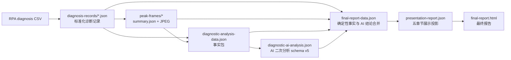

# 千川事实包、AI 分析与报告章节拆解

**分析对象：**

[`runs/qianchuan-run-20260729-20260804-top6-live-20260817`](../runs/qianchuan-run-20260729-20260804-top6-live-20260817)

**分析范围：** 当前报告的 01 至 05 章节，以及从 RPA 原始 CSV 到最终 HTML 的证据链。本文只描述当前已经实现的字段和消费关系，不引入行业 TOP1000、品牌 TopN 等本技能没有真实来源的字段。

## 1. 总体链路



当前真实批次的规模：

- 候选素材：18 条；目标 Top N：6 条；RPA 提交、接收、后处理成功均为 6 条。
- 原始诊断 CSV：6 份，位于 `diagnosis-csv/<materialId>.csv`。
- 标准化诊断 records：6 份，位于 `diagnosis-records/<materialId>.json`。
- 高光帧：36 张，即每条素材 1 张第 0 秒帧和最多 5 张点击局部峰值帧。
- 事实包：`schemaVersion: 1`；AI 输出：`schemaVersion: 5`。
- 当前运行状态为 `analysis_pending`，因此尚未生成本批次的 AI JSON 和最终 HTML；章节映射依据现有报告实现和已完成的 Top18 报告验证。

## 2. 原始事实与标准化边界

### 2.1 RPA 原始数据

原始 CSV 的落盘由 `scripts/rpa_adapter.py` 下载，波次调度与回执由 `scripts/extract_peak_frames.py`、`scripts/rpa_batch_runner.py` 控制。CSV 只负责保存连接器返回的原始诊断事实，不直接进入报告。

```text
RPA files-envelope
  -> diagnosis-csv/<materialId>.csv
  -> rpa_csv_parser.parse_diagnosis_csv()
  -> diagnosis-records/<materialId>.json
```

连接器也支持直接 records payload；这两种返回都会收敛为同一份 `diagnosis-records/<materialId>.json`。后续事实包、AI 和报告只消费该标准化 records 路径，不以 CSV 文本为业务输入。

### 2.2 高光帧事实

`scripts/peak_frame_lib.py` 从标准化 records 中的 `CLICK_COUNT` 互动曲线选择帧秒点，并使用视频 URL 下载的视频执行 FFmpeg 截帧：

```text
第 0 秒封面帧
  + CLICK_COUNT 的局部峰值（按点击数降序、秒数升序，最多 5 个）
  -> peak-frames/<materialId>/summary.json
  -> peak-frames/<materialId>/*.jpg
```

帧候选是确定性规则结果，不是 AI 选帧结果。AI 只负责查看成功 JPEG 并解释画面，不能把点击峰值同时性写成因果关系，也不能把帧秒数与某句脚本台词强行对应。

## 3. 当前事实包字段目录

事实包由 `scripts/diagnostic_analysis_lib.py::build_diagnostic_analysis()` 构造，输出为 `diagnostic-analysis/diagnostic-analysis-data.json`。

| 字段 | 来源与口径 | 类型 | AI 是否消费 | 报告是否直接消费 | 约束 |
|---|---|---|---:|---:|---|
| `period` | 最终 Top N 的分析周期 | 范围 | 是 | 是 | 不得改变日期口径 |
| `commercial` | `top-material-roi-facts-v1.json`，最终成功 Top N 的聚合 ROI | 商业指标 | 是 | 是 | 仅能解释现有消耗、金额和两项 ROI |
| `audience` | records 中的人群诊断记录聚合 | 分桶指标、偏好 | 是 | 是 | `SHOW_COUNT`、`CLICK_COUNT`、`TRANSACTION_AMOUNT` 不得混写 |
| `scripts` | records 中的脚本标签和证据句 | 标签组合、素材明细 | 是 | 是 | 事实包没有脚本分段时码，不能归因到具体帧秒 |
| `interaction` | records 中六类互动曲线，按素材汇总整体量并按相对播放位置聚合 | 总量、趋势、分桶指标 | 是 | 是 | `totalMetricValue` 是最终 Top N 各时间点 `metricValue` 汇总；总量与分布分开解释，不能写因果 |
| `delivery` | records 中投放相关事实 | 单素材投影 | 条件消费 | 是 | 缺失时必须保留数据不足边界 |
| `materials` | `top_materials_rpa_ready.json` 加 records 视频元数据 | 素材身份、排名、投放指标 | 是 | 是 | 只含 RPA 与后处理成功素材 |
| `highlights.materials` | 每条素材的 `summary.json`、成功 JPEG、缺失帧 | 帧索引、视觉资源 | 是，且必须查看 JPEG | 是 | 每张成功帧都必须恰好被 AI 分析一次 |
| `warnings`、`missingFrames` | records、帧摘要的缺失或异常 | 限制条件 | 是 | 是 | 只能写业务可见的数据不足，不能把执行过程写入报告 |

本技能当前没有行业榜单或跨品牌数据源。因此 `industryTop1000Facts`、`brandTopNFacts` 一类字段不适用；后续若新增真实来源，必须先定义其范围、来源和报告消费方，不能仅为填充报告而添加。

## 4. 01｜TOP 素材组合结论

### 4.1 事实输入

01 章的确定性事实来自：

- `commercial`：最终成功 Top N 的消耗、净成交金额、整体成交金额、净成交 ROI 和整体支付 ROI；展示引导语使用“从素材列表数据来看”。
- `audience`：展现、点击、成交三个口径下的人群分桶与偏好。
- `scripts`：一级/二级脚本标签组合、证据句和覆盖素材。
- `highlights`：最终素材的成功高光帧和帧证据引用。
- `interaction`：跨素材相对播放位置上的点击、流失、点赞、评论、转发、新增粉丝聚合曲线，以及六类指标各自的 `totalMetricValue`。

### 4.2 AI 输入与输出

AI 读取上述五类事实，输出：

```text
portfolioDimensionConclusions.commercial
portfolioDimensionConclusions.audience
portfolioDimensionConclusions.script
portfolioDimensionConclusions.highlight
portfolioDimensionConclusions.interaction
overallConclusion
```

`overallConclusion` 收缩为组合公式、优先动作和验证边界的精简总判断；每个维度结论收缩为“一个事实 + 一个判断 + 一个建议”，并必须引用对应范围的 `evidenceRefs`。素材列表维度沿用 `commercial` AI key，但报告引导语改为“从素材列表数据来看”。互动维度必须覆盖六类整体量与时序分布；人群维度必须在三个指标口径下分别检查八大人群、年龄、性别和地域；脚本维度必须同时说明一二级内容公式和脚本文案。组合结论不能复制 02、03 章节中详细洞察的原文。

### 4.3 最终展示

`scripts/qianchuan_presentation.py::_chapter01()` 将五维事实与 AI 结论投影为 `presentation.chapters.chapter01.points`：

```text
facts.commercial + ai.portfolioDimensionConclusions.commercial -> point[commercial]
facts.audience + ai.portfolioDimensionConclusions.audience -> point[audience]
facts.scripts + ai.portfolioDimensionConclusions.script -> point[script]
ai.highlightDashboard + ai.portfolioDimensionConclusions.highlight -> point[highlight]
facts.interaction + ai.portfolioDimensionConclusions.interaction -> point[interaction]
```

最终 HTML 在 01 章展示“组合结论”总判断和五条连续编号段落。第一段以加粗的“从素材列表数据来看：”引导，后续依次为人群、脚本、高光画面和互动时序；直接呈现事实判断与建议，不展示五维 Tab、维度卡片或 ROI 指标卡。事实负责证据边界，AI 只补充业务判断与下一步建议。

## 5. 02｜人群洞察

### 5.1 事实输入

本章的唯一事实主源是 `audience`：

- `audience.metrics.SHOW_COUNT`：展现次数口径的人群分桶。
- `audience.metrics.CLICK_COUNT`：点击次数口径的人群分桶。
- `audience.metrics.TRANSACTION_AMOUNT`：成交金额口径的人群分桶。
- `audience.preferences` 与 `audience.preferencesByMetric`：按口径保留的偏好人群及贡献素材。

当前技能没有独立的 `chapter02Facts` / `chapter02AiFacts` 双事实源。图表和 AI 均使用同一 `audience` 事实源，但职责不同：图表呈现确定性统计，AI 解释不同指标口径下的差异和可验证的人群假设。

### 5.2 AI 输入与输出

AI 输入为 `audience` 及合法的 `audience:*` 证据引用，输出为：

```text
batchInsights[topic=audience]
portfolioDimensionConclusions.audience
materialAnalyses[*].audienceConclusion
```

AI 必须至少输出 3 条人群洞察，分别覆盖展现次数、点击次数和成交金额；不允许将三种指标混为一个“人群表现”结论。

### 5.3 最终展示

`_chapter02()` 将 `audience.metrics` 和偏好素材投影为人群图表/标签事实；`batchInsights[topic=audience]` 作为 AI 人群洞察在本章显示。

```text
facts.audience.metrics / preferences
  -> 人群分布、偏好素材、证据引用

ai.batchInsights[topic=audience]
  -> 人群洞察正文
```

## 6. 03｜脚本洞察

### 6.1 事实输入

本章的确定性事实主源为 `scripts`：

- `scripts.labelSummary`：一级/二级标签组合、出现次数和覆盖素材 ID。
- `scripts.materials`：单素材脚本标签、证据句及可用性。

### 6.2 AI 输入与输出

AI 输入为 `scripts` 和 `script:*` 证据引用，输出为：

```text
batchInsights[topic=script]
portfolioDimensionConclusions.script
materialAnalyses[*].scriptConclusion
```

本章固定有两条组合洞察：

1. 标题以“一级二级内容公式：”开头，解释标签组合和差异。
2. 标题以“脚本文案：”开头，解释真实证据句中的利益点与表达方式。

AI 可以分析完整素材级脚本事实，但不能宣称高光帧对应某一句脚本文案，因为当前事实包没有脚本分段时码。

### 6.3 最终展示

`_chapter03()` 将 `scripts.labelSummary` 映射为一级/二级标签组，并展示两条 `batchInsights[topic=script]`。单素材脚本事实同时进入 05 章素材详情。

## 7. 04｜高光画面洞察

### 7.1 事实输入

本章的确定性事实来自 `highlights.materials[*]`：

- `frames[*].framePath`：本地 JPEG 路径，供模型实际查看和报告复制图片。
- `frames[*].rankType`、`durationSec`、`metricValue`：第 0 秒或点击局部峰值的确定性帧事实。
- `frames[*].evidenceRef`：高光帧唯一证据标识。
- `missingFrames`：预期帧未生成时的覆盖边界。

### 7.2 AI 输入与输出

AI 必须实际查看每张成功 JPEG，并输出：

```text
highlightDashboard.groups
materialAnalyses[*].highlightAnalyses[*]
portfolioDimensionConclusions.highlight
```

`highlightDashboard` 按 `portrait`、`product`、`other` 固定顺序分类。每个成功帧必须恰好归入一个分类；`highlightAnalyses` 中每张帧也必须有且仅有一条画面观察和谨慎商业解释。

### 7.3 最终展示

`_chapter04()` 直接使用 AI 的 `highlightDashboard`，并通过帧引用回查事实包中的帧元数据和图片。HTML 展示分类、共同画面结论、裂变方向和帧网格；图片资产由 `report_renderer.py` 复制到 `final-report/assets/highlight-frames/`。

```text
facts.highlights.frames
  -> 图片、秒点、点击峰值事实

ai.highlightDashboard
  -> 分类、共同结论、裂变方向
```

## 8. 05｜单素材深度分析

### 8.1 事实输入

本章按最终成功 Top N 素材展开，使用：

- `materials`：排名、素材 ID、名称、消耗等基础身份与投放事实。
- `delivery`：可用的投放/诊断事实。
- `scripts.materials`：该素材的脚本标签和证据句。
- `interaction` 与保留 records：确定性互动时序数据。
- `highlights.materials[*]`：该素材的帧事实、JPEG 和缺失帧。

报告装配阶段，`scripts/final_report_lib.py` 会重新读取 records 和 `summary.json`，构造素材卡片及互动时序；这属于确定性展示投影，不应由 AI 重新计算。

### 8.2 AI 输入与输出

AI 对每条最终素材输出一项 `materialAnalyses[*]`：

```text
audienceConclusion
scriptConclusion
highlightAnalyses[*]
frameCoverageNote
integratedConclusion
decision
nextAction
evidenceRefs
```

其中：

- `highlightAnalyses[*].frameRef` 必须逐字匹配对应帧的 `evidenceRef`。
- `frameCoverageNote` 仅在 `missingFrames` 非空时说明视觉结论的覆盖边界。
- `decision` 只能为 `scale`、`remix`、`hold`、`stop`、`unknown`。
- 单素材 AI 总结解释事实为何值得放量、保留或改写，不能重复页面已展示的时序点、标签或数值。

### 8.3 最终展示

`_chapter05()` 以素材为单位投影事实和 AI 总结。页面先展示确定性的互动时序和脚本分析数据，再显示人群、脚本、高光画面和综合决策的 AI 二次分析。

## 9. 证据引用与完整追踪链

事实包将来源压缩为可校验的证据标识；`scripts/final_report_lib.py` 在 `finalize` 阶段验证 AI JSON 的每一项引用是否属于已知事实。

| 证据前缀 | 标准化来源 | 主要 AI 输出 | 报告落点 |
|---|---|---|---|
| `commercial:*` | Top N ROI 汇总事实 | 01 商业表现结论 | 01 商业表现 Tab |
| `audience:*` | 人群分桶/偏好聚合 | 01 人群结论、02 人群洞察、05 人群总结 | 01、02、05 |
| `script:*` | 素材脚本标签与证据句 | 01 脚本结论、03 脚本洞察、05 脚本总结 | 01、03、05 |
| `interaction:*` | 相对播放位置互动曲线 | 01 互动时序结论 | 01、05 |
| `highlight:<materialId>:<rankType>` | 帧摘要、JPEG、帧秒点 | 01 高光结论、04 分类、05 单帧观察 | 01、04、05 |

完整链路如下：

```text
RPA CSV 字段
  -> rpa_csv_parser.py 标准化 records
  -> diagnostic_analysis_lib.py 聚合事实和 evidenceRefs
  -> diagnostic-analysis-data.json
  -> Prompt 指定的可消费事实范围
  -> diagnostic-ai-analysis.json 的 evidenceRefs / frameRef
  -> final_report_lib.py 证据和质量校验
  -> qianchuan_presentation.py 章节投影
  -> final-report.html 中的 Tab、图表、卡片、图片和正文
```

## 10. 后续优化的定位方法

后续内容调整先按问题所在层定位：

```text
原始事实缺失、范围错误或派生比较不足
  -> diagnostic_analysis_lib.py

事实已正确，但 AI 结论空泛、跨口径混用或不可验证
  -> diagnostic-analysis-prompt-v1.md

AI JSON 合法但质量门禁未覆盖某类问题
  -> final_report_lib.py 的 AI 校验逻辑

事实和 AI 结论正确，但章节位置、组件组合或交互不正确
  -> qianchuan_presentation.py、final-report-template.html、assets/report/
```

稳定边界：

1. RPA CSV、records、峰值帧选择与 JPEG 生成是确定性数据处理，不作为当前优化目标。
2. 事实包负责来源、口径、聚合、帧索引和缺失边界；AI 负责解释、归纳、分类与可验证策略。
3. Presentation 只负责将确定性事实和 AI 结果映射为既定五章节，不新增业务结论。
4. HTML/CSS/JS 只负责展示和交互，不重新计算业务事实，也不补写 AI 结论。

## 11. 以最终展示为目标的反向优化方法

本文档的用途不是把当前链路冻结成只能向前开发的流水线，而是为后续“先定展示，再反推数据和 AI”的改造提供共同基线。

整体优化方向应从：

```text
RPA -> 事实包 -> AI -> 报告
```

升级为：

```text
目标报告组件
  -> 需要用户看到的事实和交互
  -> 事实包需要提供的字段与口径
  -> AI 需要消费的事实范围
  -> AI 输出字段和证据要求
  -> Presentation 投影
  -> 前端组件实现
```

### 12.1 每次优化的六步闭环

1. **先定义展示目标**

   明确要优化的章节、组件、用户决策和交互。例如“02 章需要让用户比较不同点击口径下的人群差异”，而不是笼统地说“优化人群分析”。

2. **定义组件需要的确定性事实**

   明确组件展示哪些数值、标签、排序、分组、趋势、帧索引和缺失状态；确定这些内容是否可以直接从现有 `diagnostic-analysis-data.json` 读取。

3. **反推事实包改造**

   如果现有事实不足，在 `diagnostic_analysis_lib.py` 中增加真实来源可追溯的派生事实，记录清楚统计范围、指标口径和证据标识；不得让前端自行从原始 records 推导业务结论。

4. **反推 AI 输入输出**

   明确哪些事实由 AI 解释，哪些事实只由图表展示；在 Prompt 中增加章节专属输入入口、输出字段、证据要求和禁止推断规则；必要时扩展 schema v5 的兼容字段，但不破坏已有字段。

5. **同步调整 Presentation 与前端**

   `qianchuan_presentation.py` 负责把确定性事实和 AI 结果投影成稳定组件数据；HTML/CSS/JS 负责布局、Tab、筛选、图表、图片和交互，不在前端重新计算业务事实。

6. **做端到端证据验证**

   验证目标组件能从最终 HTML 反查到 AI 输出，再反查到事实包字段、标准化 records 和 RPA 原始字段；同时验证旧章节、旧字段和报告质量门禁没有回归。

### 12.2 展示目标到代码边界的映射

| 优化目标 | 首先修改 | 必须同步检查 | 不应单独修改 |
|---|---|---|---|
| 新增图表或比较维度 | `diagnostic_analysis_lib.py` | Prompt 输入、Presentation 投影、前端数据结构、证据校验 | 只在 HTML 中拼接 records |
| 改变 AI 洞察表达 | `diagnostic-analysis-prompt-v1.md` | AI JSON 字段、`final_report_lib.py` 质量门禁、章节投影 | 只改页面文案 |
| 增加高光帧分类或帧卡片 | Prompt + AI dashboard 契约 | `highlights`、本地资产复制、Presentation、前端交互 | 只改分类 CSS |
| 增加单素材诊断视图 | `materials`/`interaction`/`highlights` 事实投影 | `materialAnalyses`、素材 Tab、证据覆盖测试 | 只改素材详情模板 |

### 12.3 兼容原则

- 五个报告章节和现有主锚点保持不变；章节内部组件可以演进。
- 现有确定性事实字段优先保持兼容，新增字段采用增量方式，避免让旧报告无法渲染。
- AI 新增输出必须有合法 evidenceRefs 或 frameRef，并由 `final_report_lib.py` 统一校验。
- 前端可以改变信息密度、组件顺序和交互，但不能把未进入事实包的数值或 AI 未输出的判断写死在 HTML/JS 中。
- 当展示需求需要一个当前 RPA 不提供的事实时，必须明确标记为“数据不可用”或先扩展数据源，不能通过 AI 猜测补齐。

### 12.4 一次完整改造的交付物

每次以展示为目标的优化，至少应同时检查以下文件边界：

```text
事实生成：scripts/diagnostic_analysis_lib.py
AI 规则：prompts/diagnostic-analysis-prompt-v1.md
AI 质量：scripts/final_report_lib.py
章节投影：scripts/qianchuan_presentation.py
页面结构：templates/final-report-template.html
样式与交互：assets/report/unified-report.css / unified-report.js
回归测试：tests/test_diagnostic_analysis.py
           tests/test_final_report.py
           tests/test_qianchuan_presentation.py
```

最终验收不只检查页面是否“看起来正确”，还要检查：

```text
页面组件
  -> presentation 字段
  -> AI 输出字段或确定性事实字段
  -> fact-package evidenceRef
  -> records / RPA 原始字段
```

这样后续即使以“前端展示优化”为起点，也能同步修改事实包、AI 输入输出、章节投影和测试，避免出现页面先改了、但数据和 AI 无法支撑的断链情况。
