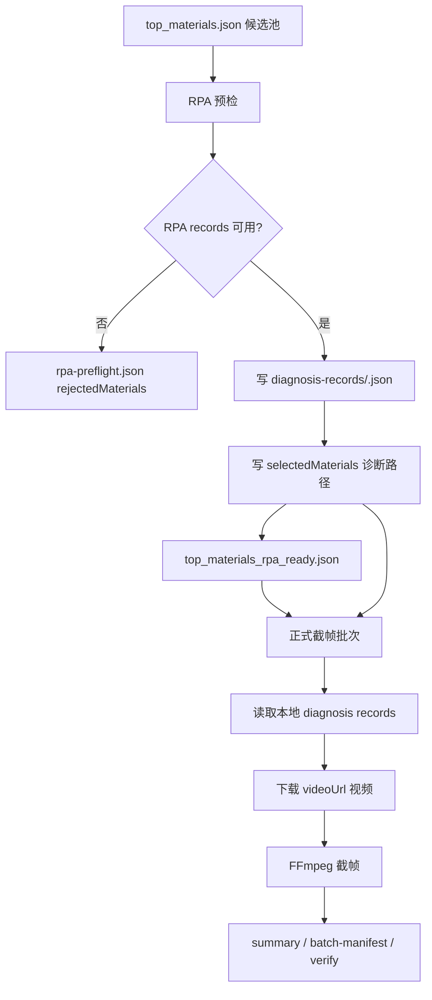

# 千川 RPA 预检数据复用设计

## 目标

在已有“RPA 预检补位”能力基础上，复用预检阶段已经成功获取的 RPA 诊断数据，避免预检通过后的素材在正式截帧阶段再次调用同一个 RPA 诊断连接器。

本设计要解决的问题是：

1. 预检通过素材已经拿到了完整诊断 records 或诊断 CSV；
2. 当前正式批次仍会再次调用 RPA 拉取同一份诊断数据；
3. 重复调用增加 RPA 成本、耗时和不稳定性；
4. 对 RPA 当前不可用的素材，仍只停留在预检阶段，不进入视频下载、FFmpeg 截帧和 summary 生成。

## 背景

当前 RPA 预检不是独立的“存在性 ping”。它调用的是正式批次同一个诊断连接器：

- `rpa.conn.juliang.qc.material.analysis.video.live.diagnosis`

因此当预检成功时，系统已经拿到后续正式截帧所需的核心数据：

- `material_info`
- `interaction_series`
- `delivery_material_detail`
- `crowd_analysis`
- `script_analysis`
- `material_info.videoUrl`

真实测试也验证了这一点：

- 素材 `7642717688218222635` 预检阶段已落下 `diagnosis-csv/7642717688218222635.csv`；
- CSV 可解析为 1700 条 records；
- records 中包含 `material_info`，且 `videoUrl` 非空；
- 这类素材理论上不需要在正式截帧阶段再次调用 RPA 诊断连接器。

## 非目标

- 不改变资产表选材排序口径；
- 不把预检失败解释为“素材已删除”；
- 不在预检阶段下载视频、运行 FFmpeg 或生成 JPEG；
- 不把预检阶段的 records 当作最终分析报告；
- 不跳过正式批次的 batch manifest、summary、JPEG 和验证流程。

## 目标行为

### 当前行为

1. 资产表导出候选池 `top_materials.json`；
2. 预检逐条调用 RPA；
3. 预检通过后写入 `top_materials_rpa_ready.json`；
4. 正式截帧读取 ready list；
5. 正式截帧再次调用 RPA 获取同一素材诊断数据；
6. 下载视频、截帧、写 summary 和 batch manifest。

### 优化后行为

1. 资产表导出候选池 `top_materials.json`；
2. 预检逐条调用 RPA；
3. 预检通过时立即持久化诊断 records 或诊断 CSV；
4. `rpa-preflight.json` 记录每个 selected 素材对应的诊断数据路径；
5. `top_materials_rpa_ready.json` 只包含预检通过的素材；
6. 正式截帧阶段优先读取预检阶段已持久化的诊断数据；
7. 只有在显式允许 fallback 时，才重新调用 RPA；
8. 正式阶段继续下载视频、运行 FFmpeg、写 summary 和 batch manifest。

## 核心原则

### 1. RPA 调用只发生在预检阶段

对于启用预检复用的批次，正式截帧阶段不得默认重新调用 RPA。

### 2. 预检成功必须有可复用数据

素材只有在以下条件都满足时，才能进入 `selectedMaterials`：

- RPA 返回可解析 records；
- records 中存在目标素材的 `material_info`；
- `material_info.videoUrl` 非空；
- records 已成功持久化到本地；
- `rpa-preflight.json` 能引用该本地持久化路径。

如果 records 可解析但写入本地失败，该素材不得视为预检通过。

### 3. 正式阶段消费本地事实

正式截帧阶段的输入从“素材 ID 列表”扩展为“素材 ID + 本地诊断数据路径”。正式阶段仍然使用现有 `process_records()` 链路，只是不再调用 `fetch_material_diagnosis()`。

### 4. 失败素材不进入后续处理

预检失败素材只保留在 `rpa-preflight.json.rejectedMaterials` 中，不下载视频、不截帧、不写正式 manifest 条目。

## 产物契约

### `rpa-preflight.json`

在现有字段基础上，扩展 `selectedMaterials` 条目。

示例：

```json
{
  "schemaVersion": 2,
  "requestedTopN": 3,
  "candidateCount": 9,
  "shopId": "shop-1",
  "dateRange": {
    "type": "CUSTOM",
    "customStartDate": "2026-06-01",
    "customEndDate": "2026-06-30",
    "actualStartDate": "2026-06-01",
    "actualEndDate": "2026-06-30"
  },
  "selectedMaterials": [
    {
      "materialId": "7642717688218222635",
      "diagnosisRecordsPath": "diagnosis-records/7642717688218222635.json",
      "diagnosisCsvPath": "diagnosis-csv/7642717688218222635.csv",
      "videoUrl": "https://example.invalid/video.mp4",
      "rpaAvailable": true,
      "failureReason": null
    }
  ],
  "rejectedMaterials": [
    {
      "materialId": "7646355189088714778",
      "rpaAvailable": false,
      "failureReason": "rpa_request_failed"
    }
  ],
  "satisfied": false
}
```

字段说明：

| 字段 | 类型 | 语义 |
| --- | --- | --- |
| `schemaVersion` | number | 复用版本使用 `2`；旧版本 `1` 不包含诊断数据路径 |
| `diagnosisRecordsPath` | string | 相对运行目录的规范化 records JSON 路径 |
| `diagnosisCsvPath` | string/null | 若 RPA 返回 files envelope，则保留原始 CSV 路径；payload 模式可为 `null` |
| `videoUrl` | string | 从 `material_info.videoUrl` 解析出的非空视频 URL |
| `rpaAvailable` | boolean | selected 条目必须为 `true` |
| `failureReason` | string/null | selected 条目为 `null`；rejected 条目记录失败分类 |

### `top_materials_rpa_ready.json`

继续保持 `top_materials.json` 的结构形状，只包含预检通过素材。

为了避免把执行细节塞进资产表契约，`top_materials_rpa_ready.json` 不强制携带诊断路径。正式阶段通过 `rpa-preflight.json` 建立 `materialId -> diagnosisRecordsPath` 映射。

### `diagnosis-records/<materialId>.json`

预检通过素材必须写入规范化 records JSON。

要求：

- JSON root 是 records list；
- 路径稳定；
- 写入使用原子替换；
- material ID 来自已验证的候选池条目；
- 不保留带签名的临时 CSV URL。

### `diagnosis-csv/<materialId>.csv`

当 RPA 返回 files envelope 时保留原始 CSV。

要求：

- 下载完成后再解析；
- 解析失败时该素材预检失败；
- CSV 可用于后续人工排查；
- CSV 路径可写入 `rpa-preflight.json.selectedMaterials[].diagnosisCsvPath`。

## 数据流



## CLI 行为

### 预检阶段

命令仍使用现有入口：

```bash
python scripts/extract_peak_frames.py \
  --source rpa \
  --top-materials-json "/path/to/run/top_materials.json" \
  --target-top-n 3 \
  --preflight-only \
  --date-range-type CUSTOM \
  --custom-start-date 2026-06-01 \
  --custom-end-date 2026-06-30 \
  --diagnosis-records-dir "/path/to/run/diagnosis-records" \
  --output-dir "/path/to/run/peak-frames"
```

预检阶段必须写：

- `/path/to/run/peak-frames/rpa-preflight.json`
- `/path/to/run/peak-frames/top_materials_rpa_ready.json`
- `/path/to/run/diagnosis-records/<materialId>.json`
- `/path/to/run/diagnosis-csv/<materialId>.csv`，仅 files envelope 场景

### 正式阶段

正式阶段新增或复用参数，显式消费预检回执：

```bash
python scripts/extract_peak_frames.py \
  --source rpa \
  --top-materials-json "/path/to/run/peak-frames/top_materials_rpa_ready.json" \
  --rpa-preflight-json "/path/to/run/peak-frames/rpa-preflight.json" \
  --date-range-type CUSTOM \
  --custom-start-date 2026-06-01 \
  --custom-end-date 2026-06-30 \
  --diagnosis-records-dir "/path/to/run/diagnosis-records" \
  --output-dir "/path/to/run/peak-frames"
```

建议新增参数：

- `--rpa-preflight-json`
  - 指向预检回执；
  - 正式批次从中读取 selected 素材的诊断 records 路径；
  - 如果该参数存在，正式批次默认不调用 RPA。

- `--allow-rpa-refetch`
  - 默认关闭；
  - 仅用于预检 records 缺失、损坏或人工确认需要刷新时；
  - 开启后可以回退到现有 `fetch_material_diagnosis()` 行为。

## 正式阶段校验规则

当传入 `--rpa-preflight-json` 时，正式阶段必须在下载视频前校验：

1. `rpa-preflight.json.satisfied=true`；
2. ready list 的所有 `materialId` 都存在于 `selectedMaterials`；
3. `selectedMaterials[].diagnosisRecordsPath` 存在且可读；
4. records JSON root 是 list；
5. records 中存在目标素材 `material_info.videoUrl`；
6. `rpa-preflight.json.dateRange` 与当前 CLI 日期参数一致；
7. `shopId` 与当前解析后的 `shop_id` 一致。

任一校验失败时：

- 默认直接失败；
- 不启动正式批次；
- 不写该素材的成功 manifest；
- 只有用户显式传入 `--allow-rpa-refetch` 时才允许重新拉 RPA。

## 实现边界

### `scripts/rpa_adapter.py`

新增或调整：

- 预检函数返回 records 或 records path，而不只返回 pass/fail；
- files envelope 场景继续保留 CSV；
- payload 场景也要写 normalized records JSON；
- 错误分类保持现有 `rpa_request_failed`、`rpa_payload_invalid`、`missing_material_info`、`missing_video_url`。

### `scripts/extract_peak_frames.py`

新增或调整：

- 预检成功后立即写 `diagnosis-records/<materialId>.json`；
- `rpa-preflight.json` 增量写入 selected/rejected 进度；
- `top_materials_rpa_ready.json` 仍只表达 ready 素材名单；
- 正式阶段增加 `--rpa-preflight-json`；
- `_process_rpa_material()` 支持从 records path 读取 records；
- 只有无预检回执或显式 `--allow-rpa-refetch` 时才调用 RPA。

### `references/rpa-output-contract.md`

补充：

- 预检成功即本地诊断数据已可复用；
- `rpa-preflight.json` schemaVersion 2；
- 正式阶段复用 records 的校验规则；
- `--allow-rpa-refetch` 的风险和使用边界。

### `SKILL.md`

更新 TOP 素材批量运行流程：

1. 导出候选池；
2. 运行 RPA 预检补位；
3. 检查 `rpa-preflight.json.satisfied`；
4. 正式阶段传入 `top_materials_rpa_ready.json` 和 `rpa-preflight.json`；
5. 正式阶段默认复用预检 records，不重复调用 RPA。

## 兼容策略

### 旧流程兼容

不传 `--rpa-preflight-json` 时，正式 RPA 批次保持现有行为：

- 按 `top_materials.json` 或 ready list 中的素材 ID 调用 RPA；
- 下载视频；
- 截帧；
- 写 manifest。

### 旧 `rpa-preflight.json` 兼容

如果传入的 `rpa-preflight.json.schemaVersion=1`：

- 默认报错提示该回执不包含 `diagnosisRecordsPath`；
- 用户可选择重新运行预检生成 schemaVersion 2；
- 或显式传 `--allow-rpa-refetch` 回退到重新拉 RPA。

### 中断恢复

预检阶段继续支持增量产物：

- 已 selected 的素材保留 records；
- 已 rejected 的素材保留失败原因；
- 中断后重新预检时，可优先复用本地已存在且校验通过的 records，避免重复调用 RPA；
- 若本地 records 损坏，则该素材重新预检或失败。

## 测试要求

至少覆盖：

1. 预检成功时写入 `diagnosis-records/<materialId>.json`；
2. files envelope 场景同时保留 CSV 和 normalized records JSON；
3. `rpa-preflight.json.selectedMaterials` 包含 `diagnosisRecordsPath`；
4. 正式阶段传入 `--rpa-preflight-json` 时不调用 `fetch_material_diagnosis()`；
5. 正式阶段从 records JSON 中读取 `material_info.videoUrl` 并继续下载视频、截帧；
6. `rpa-preflight.json.satisfied=false` 时正式阶段拒绝启动；
7. ready list 中素材不在 selectedMaterials 时拒绝启动；
8. records JSON 缺失或不可解析时拒绝启动；
9. `--allow-rpa-refetch` 开启时允许回退到现有 RPA 拉取；
10. 旧 schemaVersion 1 回执默认拒绝复用；
11. 中断后重新预检时复用已有 selected records；
12. 单素材 RPA 不可用时仍不会进入视频下载和 FFmpeg。

## 风险与取舍

- 预检成功后到正式截帧之间，远端 RPA 数据可能发生变化；本设计选择复用本地事实以保证批次稳定性。
- 复用 records 能减少 RPA 调用，但不会减少视频下载和 FFmpeg 成本。
- 本地 records 成为正式批次关键输入，必须严格校验路径、日期、shopId 和 materialId。
- 如果业务要求“正式阶段必须获取最新诊断数据”，需要显式使用 `--allow-rpa-refetch`，并接受重新触发 RPA 不稳定性的风险。

## 成功标准

该优化完成后，一次目标 Top 3 的真实批次应满足：

1. 候选池中失败素材只在预检阶段失败；
2. 预检通过素材的 records 已落盘；
3. 正式阶段对 ready 素材不再调用 RPA 诊断连接器；
4. 正式阶段仍生成 JPEG、summary、batch manifest；
5. `--verify` 只验证 ready 素材；
6. RPA 调用次数约等于预检扫描候选数，而不是预检扫描数加正式 ready 数。

