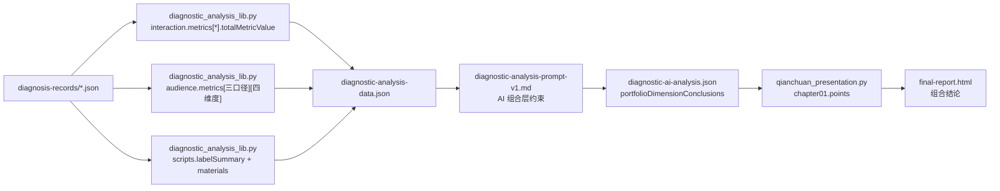

# 千川第 01 章事实覆盖设计

## 目标

让第 01 章“组合结论”在不改变 RPA、CSV、标准化 records、高光帧抽取及章节布局的前提下，完整消费可追溯的素材列表、人群、脚本和互动事实。

## 已确认事实边界

- 组合层 `commercial` 保持现有 schema key；最终展示引导语改为“从素材列表数据来看”。
- 互动序列的整体次数，定义为最终 Top N 素材中同一 `interactionMetric` 的所有有效时间点 `metricValue` 之和。该值与相对播放位置分桶并存，前者表达量级，后者表达分布。
- 人群事实不新增字段。`SHOW_COUNT`、`CLICK_COUNT`、`TRANSACTION_AMOUNT` 都已提供八大人群、年龄、性别和地域（省份/城市）维度。
- 脚本事实不新增字段。一级/二级标签组合、完整脚本文案与证据句已经在 `scripts` 中。

## 数据流

## 行为设计

### 素材列表数据

`portfolioDimensionConclusions.commercial` 的字段和证据仍使用 `commercial`，只把第 01 章呈现引导语改为“从素材列表数据来看”。这样不改变 AI JSON 契约和历史报告兼容性。

### 互动时序数据

`interaction.metrics` 的六个指标 `CLICK_COUNT`、`LOSE_COUNT`、`LIKE_COUNT`、`COMMENT_COUNT`、`SHARE_COUNT`、`NEW_FOLLOWER_COUNT` 均增加 `totalMetricValue`。不可用指标不生成总量，保持 `available: false`、空分桶和零样本数。

AI 的互动结论必须覆盖六项指标中事实包实际可用的总量与时序分布；总量与分桶证据分别引用 `interaction:{metric}:total` 和 `interaction:{metric}:{bucket}`。结论不能把时序同时性写成因果。

### 人群数据

提示词要求 AI 在展现次数、点击次数、成交金额三个口径下，都检查八大人群、年龄、性别、地域。结论只选能支持业务判断的关键分桶，分别引用对应 `audience:{metric}:{dimension}:{bucket}`，不把不同口径的值混写。

### 脚本数据

提示词要求脚本结论同时覆盖两条分析线：

1. 一级二级内容公式：标签组合、覆盖素材和可复用的内容结构。
2. 脚本文案：来自真实证据句的利益点、表达方式、行动指令及下一轮改写假设。

## 验收

- 互动聚合测试证明六项指标的整体总量等于每条素材各时间点事实值的和，且保留既有分桶行为。
- 第 01 章测试证明首条引导语为“从素材列表数据来看”。
- 提示词测试证明人群、互动、脚本约束都包含新要求。
- 使用真实 Top6 批次重新生成事实包、AI JSON 和最终报告；第 01 章 AI 结论引用新增互动总量证据且符合 schema 门禁。
