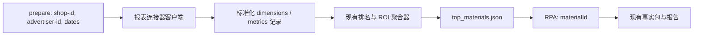

# 直连素材报表取数迁移设计

## 目标

将标准分析工作流的候选素材与 ROI 事实数据来源，从资产表的按日分区查询迁移为巨量千川全域推广连接器的一次聚合查询。保留现有 `top_materials.json`、ROI 事实、RPA 批处理和报告契约，连接器返回的 `material_id` 原样作为 RPA 的 `materialId`。

## 范围

- `prepare` 接收必填 `--shop-id`，它同时是报表连接器与 RPA 的授权店铺。
- 使用参考技能的 `OCEANENGINE_UNI_PROMOTION_PLAN_DATA_REQUESTS_ZDY` 连接器、认证上下文与文件结果处理方式。
- 以素材视频维度查询用户提供的广告主和闭区间日期，获取完整周期的聚合数据。
- 保留现有按素材汇总、过滤、候选扩容、补位、RPA 与报告生成逻辑。

不支持资产表回退，不接受任意 SQL、维度、指标或过滤条件覆盖，也不改变 RPA 诊断连接器。

## 架构

新增一个仅负责报表连接器调用与记录归一化的模块。它从环境中独立解析请求体会话和 Cookie 会话：请求体优先 `YUCE_SESSION_ID`，Cookie 优先 `YCSESSIONID`，两者分别回退到 `YUCE_AUTHORIZATION`。认证信息不得进入运行摘要、日志、错误文本或落盘数据。

导出模块调用该客户端一次，并把返回记录序列化为与资产表 `origin_data` 相同的 JSON 字符串，交给现有 `MaterialAggregator` 与 `AssetMetricsAggregator`。因此下游输出格式和 `materialId` 传递路径不变；资产表客户端不再被标准工作流引用。

## 连接器契约

客户端调用 `POST /adg/v1/agent/invoke`，使用：

- `data_source_type: api`
- `platform: OCEANENGINE`
- `function_code: OCEANENGINE_UNI_PROMOTION_PLAN_DATA_REQUESTS_ZDY`
- `response_content_type: fetch`
- 调用方传入的 `shop_id`

业务参数固定为 `OVERALL_ROI_LIVE_MATERIAL_VIDEO`，维度包含 `material_id`、`anchor_id`、`roi2_material_video_name`、`roi2_material_type_v3`、`roi2_material_video_type`；不包含 `stat_time_day`，使整个分析周期按素材聚合。指标至少包含现有排名和 ROI 事实所需的：

- `stat_cost_for_overall_roi2`
- `total_order_settle_amount_for_roi2_1h`
- `total_pay_order_gmv_include_coupon_for_roi2`

为保持与参考技能及下游分析的口径一致，使用参考技能的完整默认指标集和默认视频素材过滤。排序使用 `stat_cost_for_roi2` 降序，但本地仍按 `stat_cost_for_overall_roi2` 聚合后稳定排序，作为唯一候选排名依据。

日期转换为连接器的 `yyyy-MM-dd HH:mm:ss`：开始日 `00:00:00`，结束日 `23:59:59`。

## 结果与失败处理

支持直接记录列表、`result_type=payload` 和 `result_type=files`。文件返回时：保留网关元数据 JSON、下载原始单列 JSON CSV 并结构化为 JSON 数组；仅当结构化成功并获得非空记录时继续。文件下载失败、CSV 非法、认证失败、网关失败或缺少必填字段都使选择阶段失败，不写部分候选或将指标填为零。

运行目录新增报表源数据目录，保存该次选择的网关元数据和原始/结构化结果，便于审计。运行摘要增加该报表源元数据的相对路径；不保存会话或 Cookie 值。`shopId` 进入请求摘要和工作流锁键，防止同一输出父目录中不同店铺的同参运行互相抢锁。

## RPA 参数传递

现有 `top_materials.json` 的 `materials[*].materialId` 继续来自聚合后的 `dimensions.material_id.Value`。`prepare_standard_run` 将同一个必填 `shop_id` 传入 `extract_peak_frames`，后者再调用现有 RPA 适配器的 `build_business_params(material_id=...)`。不转换为数字、不重命名、不以视频名称替代素材 ID。

## 测试

- 覆盖认证上下文的独立回退、请求封装、默认查询契约和凭据脱敏。
- 覆盖直接记录、payload 和 files 三种结果，使其均可驱动现有排名和 ROI 事实聚合。
- 覆盖文件下载/结构化失败、缺字段和 HTTP 401 的选择阶段失败语义。
- 覆盖 `prepare --shop-id` 必填校验、同店铺 ID 同时传入数据连接器和 RPA、锁键隔离与运行摘要审计路径。
- 运行当前素材选择、标准工作流、RPA 参数和技能契约测试，确认旧资产表不再是有效取数路径。
