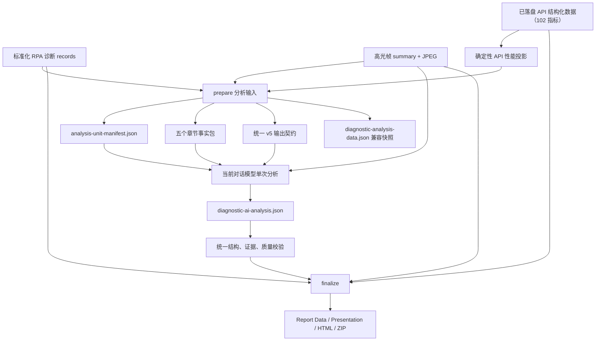

# 千川数据分析输入模块化设计

## 1. 背景与目标

千川技能分为两个能力阶段：

1. 数据获取与后处理：通过巨量千川 API 获取素材列表和经营数据，以素材 ID 调用 RPA 获取脚本、互动时序、人群等诊断数据，再完成 CSV 标准化、视频处理和高光帧提取。
2. 数据分析与报告：将后处理数据组织为模型事实输入，由当前对话模型完成 AI 二次分析，生成结构化 JSON，经校验后渲染五章报告。

本轮只优化第二阶段。API、RPA、CSV 标准化、候选补位、视频下载、峰值帧选择和 JPEG 生成保持不变。

第一阶段采用以下硬约束：

- 保持现有五章报告结构和展示行为。
- 保持 `diagnostic-ai-analysis.json` 的 `schemaVersion: 5` 输出契约。
- 由当前对话模型在一次调用中完成全部分析，不拆成五次模型调用。
- 当前对话模型必须实际查看全部可用本地 JPEG。
- 不接入外部模型服务，不通过 `codex exec` 或子进程替代当前对话模型。
- 不重新调用 API 或 RPA 验证分析层改造；真实回归只读取既有落盘数据。

目标是降低模型输入体积和认知负担，同时提高各章节分析规则的隔离性、证据完整性和后续可维护性。

## 2. 当前证据

当前标准链路为：

```text
prepare
  -> diagnostic-analysis-data.json
  -> 当前模型生成 diagnostic-ai-analysis.json
  -> finalize 内完成 schema、证据和质量校验
  -> final-report-data.json / presentation-report.json / HTML / ZIP
```

四个完整真实运行的体积如下：

| 批次 | 事实包 | AI JSON | 成功高光帧 |
|---|---:|---:|---:|
| Top3 | 297,785 bytes | 25,140 bytes | 18 |
| Top3 | 370,396 bytes | 28,925 bytes | 18 |
| Top18 | 1,004,011 bytes | 122,412 bytes | 107 |
| 最新 API Top6 | 544,024 bytes | 42,843 bytes | 34 |

最新主基线 `runs/qianchuan-20260810-20260820-top6` 证明第一阶段已经使用新版 API 落盘契约：

- API 原始 CSV 为 30,054,831 bytes，结构化 JSON 为 35,563,894 bytes，共 1,147 条记录。
- `field-manifest.json` 实际声明 8 个维度和 102 个指标；102 指标不是未来能力，而是当前已落盘能力。
- `asset-material-facts-v1.json` 为 219,972 bytes、覆盖 1,146 个素材，但只投影成本、1 小时净结算金额和整体支付金额三个原子指标。
- `top-material-roi-facts-v1.json` 在上述三个原子指标上确定性派生聚合成本、金额、净结算 ROI 和整体支付 ROI。
- 当前模型事实包的 `delivery` 仍来自六份 RPA diagnosis record，共 66 条素材/日期记录，并非 102 指标 API 数据的完整分析投影。
- 当前事实包主要字段为 `audience` 330,722 bytes、`delivery` 179,767 bytes、`highlights` 12,058 bytes、`scripts` 11,754 bytes、`materials` 6,883 bytes、`interaction` 2,216 bytes、`commercial` 432 bytes（均按 UTF-8 序列化字节统计）。

Top18 事实包中的主要字段体积：

| 字段 | 字节数 | 占事实包约比 |
|---|---:|---:|
| `audience` | 646,051 | 64% |
| `delivery` | 244,126 | 24% |
| `scripts` | 55,250 | 6% |
| `highlights` | 35,023 | 3% |
| `materials` | 20,698 | 2% |

主要问题：

- `audience.metrics`、`preferences`、`preferencesByMetric` 同时保存相近的人群信息，并在桶级重复素材 ID。
- `delivery` 在 Top18 中包含 90 条日期明细和约 100 个不同字段，但当前证据校验没有 `delivery:*` 引用域。
- 最新 API 的 102 个指标已经完整落盘，但分析层只消费三指标 ROI 投影；因此 Chapter 01 和 Chapter 05 尚未系统利用新版 API 的曝光、点击、播放、订单和交易等经营事实。
- `materials.video` 包含模型被 Prompt 明确禁止引用的临时视频与封面 URL。
- 当前事实包同时承载组合层、章节层和单素材层需要的数据，修改一个章节容易影响其他章节。
- 当前 Prompt 同时承担事实说明、五章映射、v5 Schema、质量长度、证据规则、图片审阅和失败修正规则，局部优化成本较高。
- `finalize` 会从标准化 records、ROI 事实和高光摘要重新构造报告展示数据，因此完整 `diagnostic-analysis-data.json` 并不是报告渲染的直接依赖。

### 2.1 数据源权威边界

第二阶段必须明确区分两个事实平面，不能再把 RPA `delivery` 视为全部经营表现的默认来源：

1. **API 性能事实平面**：来自已经落盘的结构化 API 数据，负责素材身份、排名、消耗、曝光/点击、视频播放、订单、交易和 ROI 等经筛选的经营指标，主要服务 Chapter 01 和 Chapter 05。
2. **RPA 诊断事实平面**：来自标准化 diagnosis records、高光摘要和 JPEG，负责人群、脚本、互动时序、帧提取所需视频元数据及视觉证据，主要服务 Chapter 02、Chapter 03、Chapter 04，并补充 Chapter 05 的诊断解释。

API 性能事实平面不是把 102 个指标原样传给模型。`prepare` 应从既有结构化 API 产物生成面向最终 Top N 的确定性分析投影；每个入选指标必须绑定业务问题、章节消费者、聚合规则和可校验证据引用。完整 102 指标数据继续留在 source-data 中用于审计和报告兼容。

### 2.2 云图优化经验的迁移边界

直接迁移的经验：

- 先按报告消费面收敛事实和 AI 输出契约，再优化 Prompt。
- 章节事实包服务维护隔离，但由当前对话模型一次读取、一次输出。
- 展示专用数据、临时 URL、重复明细和执行元数据不进入模型输入。
- 结构、证据和质量规则使用一个统一验证入口，并在来源证明或报告写入前执行。
- 使用固定真实批次做正向与故意破坏证据的反向回归。

不直接照搬的结构：

- 云图保留独立 `report-data.json`；千川已经从 records 和高光摘要重建报告事实，不新增同类文件。
- 云图有四个主要 AI 输出模块；千川保留现有五章和 v5 六个顶层字段，不重新设计输出 Schema。
- 云图已有独立 attest；千川先把校验前移到 `finalize`，不为形式一致新增公共命令。

## 3. 方案选择

### 3.1 候选方案

| 方案 | 优点 | 缺点 | 结论 |
|---|---|---|---|
| 只优化 Prompt | 改动小 | 事实包体积和职责混合不变 | 不采用 |
| 章节事实包、单次模型调用 | 输入边界清晰，可局部维护，保留跨章节推理 | 需要定义 manifest 和跨包引用 | 采用 |
| 五次模型调用 | 单元运行隔离最强 | 重复加载事实和图片，跨章结论割裂，重试复杂 | 不采用 |

### 3.2 核心决策

隔离的是事实组织、单份 Prompt 内的章节规则和校验模块，不是 Prompt 文件或模型调用次数。模型在同一次调用中读取 manifest、五个章节事实包、唯一 Prompt 和全部 JPEG，输出一份完整 v5 JSON。

## 4. 目标链路



`diagnostic-analysis-data.json` 第一阶段继续生成，用于历史兼容、调试和改造前后对照，但不再作为新模型分析输入。千川不新增云图式 `report-data.json`，因为现有 `finalize` 已从确定性来源重建报告数据。

## 5. 目录与输入契约

```text
diagnostic-analysis/
├── diagnostic-analysis-data.json          # 兼容快照，新模型不读取
├── diagnostic-analysis-prompt.md          # 唯一 Prompt 的运行时副本
├── diagnostic-ai-analysis.json            # 当前 v5 输出
└── analysis-units/
    ├── analysis-unit-manifest.json
    ├── chapter01-portfolio-input.json
    ├── chapter02-audience-input.json
    ├── chapter03-script-input.json
    ├── chapter04-highlight-input.json
    └── chapter05-material-input.json
```

manifest 负责：

- 标识 `executionMode: single_model_call`。
- 声明公共周期、素材范围、Schema 版本和五个单元路径。
- 保存每个事实包的字节数和 SHA-256。
- 声明单元对应的报告章节、AI 输出字段和允许的证据前缀。
- 保存成功 JPEG 数量、缺失帧数量和素材 ID 顺序。
- 不重复嵌入五个事实包的业务数据。

## 6. 五个章节事实包

### 6.1 Chapter 01：组合结论

`chapter01-portfolio-input.json` 只保存组合层事实：

- 周期和最终素材顺序。
- 来自 API 性能事实平面的素材身份、排名和必要经营摘要。
- 来自 API 的 Top N 聚合消耗、曝光/点击、播放、订单、交易和 ROI 等已选经营指标。
- 来自 RPA 诊断事实平面的六类互动总量和相对播放位置分布。
- 五个组合维度可引用的证据域索引。
- 其他章节事实包的依赖声明，不复制完整人群桶、脚本正文或逐帧观察。

Chapter 01 中任何 API 指标都必须有明确的跨素材聚合口径。成本、金额和计数可按定义加总；ROI、转化率等比率必须由明确分子/分母重新计算，不能对素材级比率取简单平均。

对应输出：

- `overallConclusion`
- `portfolioDimensionConclusions.commercial`
- `portfolioDimensionConclusions.audience`
- `portfolioDimensionConclusions.script`
- `portfolioDimensionConclusions.highlight`
- `portfolioDimensionConclusions.interaction`

### 6.2 Chapter 02：人群洞察

`chapter02-audience-input.json` 保存：

- `SHOW_COUNT`、`CLICK_COUNT`、`TRANSACTION_AMOUNT` 三种口径。
- 八大人群、年龄、性别、地域等全部可用维度。
- 每个桶的值、占比和确定性 `audience:*` 证据引用。
- 维度级样本数量、缺失素材和长尾汇总。

第一阶段不删除业务维度或桶。压缩方式优先采用：

- 删除桶级重复 `sourceMaterialIds`，只在确有分析用途的层级保留来源信息。
- 合并 `preferences` 与 `preferencesByMetric` 的重复结构。
- 直接生成证据引用，避免模型自行拼接。

对应输出：

- `batchInsights[topic=audience]`
- Chapter 01 的人群组合结论

### 6.3 Chapter 03：脚本洞察

`chapter03-script-input.json` 保存：

- 一级、二级标签组合和覆盖数量。
- 单素材完整脚本文案、标签和真实证据句。
- 确定性 `script:*` 引用。

删除仅用于展示投影的重复结构；不得建立脚本帧时码，因为当前数据源不提供该契约。

对应输出：

- `batchInsights[topic=script]`
- Chapter 01 的脚本组合结论

### 6.4 Chapter 04：高光画面

`chapter04-highlight-input.json` 保存：

- 每张成功帧的 `materialId`、`rankType`、秒点、指标值、JPEG 路径和 `evidenceRef`。
- 每条素材的 `missingFrames` 和覆盖状态。
- JPEG 总数和逐素材帧数。

不包含人群、脚本、完整投放字段或视频 URL。当前对话模型必须实际查看所有成功 JPEG，每张帧在 dashboard 和单素材观察中都必须恰好覆盖一次。

对应输出：

- `highlightDashboard`
- `materialAnalyses[*].highlightAnalyses`
- `materialAnalyses[*].frameCoverageNote`
- Chapter 01 的高光组合结论

### 6.5 Chapter 05：单素材深度分析

`chapter05-material-input.json` 按 `materialId` 建立紧凑素材切片：

- 去除 URL 后的素材身份和排名。
- 来自 API 性能事实平面、经过业务白名单筛选的单素材消耗、曝光/点击、播放、订单、交易和 ROI 表现。
- 来自 RPA 诊断事实平面的三种口径单素材主要人群偏好。
- 来自 RPA 诊断事实平面的单素材互动总量、关键时序和数据可用性。
- 对应脚本证据引用和高光帧引用，不复制脚本正文与 JPEG 元数据。
- 缺失数据边界。

当前 RPA `delivery` 的约 100 字段自由字典不得原样进入新模型包；当 API 已提供同口径经营事实时，应删除或显著收缩对应的 RPA `delivery` 输入。进入单素材包的 API 或 RPA 字段必须满足至少一个条件：

1. 直接支持报告中现有业务判断；
2. 能生成稳定、可验证的证据引用；
3. 有明确的加总、比率或最新值口径。

无法安全聚合的比率只保留明确口径的最新值，或标记不可用。现有 102 个 API 指标不得默认全部传给模型；选入投影的指标必须先绑定业务问题、章节消费者、聚合规则和证据域。

不得直接扩充 `asset-material-facts-v1.json` 来承担全部分析输入。该文件继续保持三指标 ROI 来源证明职责；新增独立的 API 分析投影，或在章节事实包中建立清晰隔离的 `apiPerformance` 区域，避免审计事实与模型分析投影耦合。

对应输出：

- `materialAnalyses`

## 7. Prompt 组织

继续只维护一个权威源文件：

```text
prompts/diagnostic-analysis-prompt-v1.md
```

`prepare` 保持现有行为，将该文件原样复制为运行目录中的 `diagnostic-analysis-prompt.md`。不新增 `prompts/analysis-units/`，不做 Prompt 片段拼装，也不生成多个章节 Prompt。

单份 Prompt 内部按固定顺序组织规则：

1. 通用执行契约：当前对话模型身份、一次调用、v5 顶层输出、证据边界、因果限制、JSON 输出和 JPEG 全量查看。
2. Chapter 01：声明组合结论的业务问题、`chapter01-portfolio-input.json` 和输出字段。
3. Chapter 02：声明人群事实包、三种指标口径、证据前缀和输出字段。
4. Chapter 03：声明脚本事实包、内容公式与脚本文案规则。
5. Chapter 04：声明视觉事实包、逐帧覆盖、分类和缺失帧规则。
6. Chapter 05：声明单素材事实包、素材级输出、决策枚举和质量要求。
7. 统一生成前自检：一次检查素材、帧、证据、字段数量和文本质量，再写一份完整 JSON。

章节标题和输入映射形成局部维护边界，但通用规则只出现一次。修改某章分析思路时只调整同一 Prompt 的对应章节，不复制公共规则，也不改变模型调用次数。

## 8. 输出与统一校验

第一阶段保持现有 v5 输出字段：

```text
schemaVersion
overallConclusion
portfolioDimensionConclusions
batchInsights
highlightDashboard
materialAnalyses
```

现有 `final_report_lib.py` 同时承担分析规范化、证据校验、质量校验和报告装配。后续应提取一个无副作用的统一入口，例如：

```text
validate_analysis_input(analysis_json, analysis_manifest, analysis_units)
```

校验分三层：

1. 结构校验：v5 字段、类型、枚举、数量和文本范围。
2. 证据校验：素材 ID、`evidenceRefs`、`frameRef`、帧覆盖和章节证据域。
3. 质量校验：重复内容、禁用归因、空泛文本、不同素材结论复用和执行过程叙事。

`finalize` 必须在修改运行状态、创建报告目录和写入报告前调用该统一入口。报告渲染继续消费已经验证和规范化的结果，不复制业务校验规则。

千川当前没有独立 attest 命令。第一阶段不为形式对齐而新增公共命令；若后续需要来源证明，应在统一校验稳定后增加可验证回执，并确保回执写入发生在校验通过之后。`generator` 文本本身不得视为模型身份凭证。

## 9. 兼容与迁移

- `diagnostic-ai-analysis.json` v5 不变，现有报告渲染器和 Presentation 无需迁移。
- `diagnostic-analysis-data.json` 第一阶段继续生成，作为历史兼容快照和 A/B 基线。
- 新运行从既有结构化 API 数据生成 Top N 性能投影，并只把 manifest、五个章节包、单份 Prompt 和 JPEG 交给模型。
- 历史运行仍允许使用旧完整事实包重新分析或渲染。
- 新旧批次通过来源适配层进入相同章节包契约：新版批次优先使用 API 性能事实；缺少新版 API 产物的历史批次可使用当前已验证的 ROI/RPA 兼容投影，并明确标记字段可用性和来源。
- 当至少两个规模不同的真实批次稳定通过后，再评估是否停止生成完整兼容快照。
- 不引入四包/五包结果合并器，因为模型仍然输出一个完整 v5 JSON。

## 10. 异常与部分数据

- 没有成功高光帧：视觉章节按现有业务规则降级，不阻塞人群和脚本分析；具体 v5 是否允许缺省需在实现前用现有渲染契约确认。
- 某素材缺少部分帧：保留 `missingFrames`，要求 `frameCoverageNote` 说明覆盖边界。
- 某素材缺少人群、脚本或互动数据：只在该素材对应字段内说明数据不足，不生成执行质量章节。
- 章节包、manifest 字节数或 SHA-256 不一致：拒绝进入模型交接或 finalize。
- 模型引用其他章节不允许的证据前缀：统一校验失败，不写报告。
- 校验失败：仅修改当前 AI JSON 后重新运行校验/finalize，不重新运行 API、RPA 或后处理。

## 11. 实施批次

### 批次 A：事实输入模块化

- 以最新 API Top6 批次建立主设计和固定回归基线，并保留 Top18 作为规模与历史兼容基线。
- 从已落盘结构化 API 数据生成确定性的 Top N 性能分析投影，不改变 API 获取和落盘流程。
- 生成 manifest 和五个章节事实包。
- 保留完整兼容快照。
- 不修改 Prompt 业务规则、v5 输出和报告渲染。
- 证明每个包不泄漏其他章节的大型展示或原始明细。

### 批次 B：单份 Prompt 与校验隔离

- 在现有唯一 Prompt 内建立通用规则和五个章节的固定边界。
- 提取统一分析校验入口。
- `finalize` 在产生副作用前执行统一校验。
- 将已确认的当前对话模型身份约束固化到 `SKILL.md` 和唯一 Prompt。

### 批次 C：真实模型 A/B 与兼容收口

- 使用最新 API Top6 批次执行当前对话模型主质量 A/B，验证 API/RPA 双事实平面和 34 张帧引用。
- 使用 Top18 批次验证规模、历史字段覆盖、107 张帧引用和报告兼容。
- 比较分析耗时、模型输入体积、校验失败数、章节完整度和报告产物。
- 评估完整兼容快照的后续保留周期。

## 12. 验收标准

### 12.1 体积与速度

- 最新 API Top6 五个模型事实包总字节数相对当前 544,024 bytes 有明确下降，并单独记录 API 性能投影与 RPA 诊断投影体积。
- Top18 五个模型事实包总字节数相对当前 1,004,011 bytes 至少降低 30%。
- 不通过删除现有业务维度或隐藏缺失数据达到体积目标。
- 唯一 Prompt 的总体积不得因章节重组显著增长，且仍为一次模型指令。
- 记录当前模型分析实际耗时，A/B 使用同一真实批次和同一输出契约。

### 12.2 数据与分析完整性

- Chapter 01 和 Chapter 05 的经营事实来自最新 API 性能投影；不得在 API 已提供同口径数据时继续默认采用 RPA `delivery`。
- 每个入选 API 指标都有业务问题、章节消费者、聚合规则、数据来源和合法证据引用；未入选指标仍完整保留在 source-data 审计产物中。
- 比率类组合指标按明确分子/分母重算，测试禁止简单平均素材级 ROI 或转化率。
- Chapter 02 保留三种人群口径和全部现有维度。
- Chapter 03 保留标签组合、完整脚本文案和真实证据句。
- Chapter 04 的每张成功 JPEG 被实际查看，且在 dashboard 和单素材观察中各覆盖一次。
- Chapter 05 对每条成功素材保留一项 `materialAnalyses`。
- Chapter 01 五个组合维度均有对应事实和合法引用。

### 12.3 兼容与报告

- 新章节包仍能生成现有 v5 AI JSON。
- 旧完整事实包和既有 v5 AI JSON 仍能完成 finalize。
- HTML、Report Data、Presentation JSON 和 ZIP 正常生成。
- 五章 ID、导航、素材数量、帧数量和引用集合保持一致。
- 任一非法素材 ID、未知证据、重复帧、遗漏帧或空泛质量字段在报告写入前被拒绝。

### 12.4 验证批次

- 主设计与质量 A/B：`runs/qianchuan-20260810-20260820-top6`，必须验证 1,147 条 API 记录、8 个维度、102 个指标、六条最终素材和 34 张成功帧的来源边界。
- 规模与历史兼容回归：`runs/20260730-20260803-top18`。
- 补充旧 Top3 口径回归：`runs/2026-07-30_to_2026-08-04_top3_1770096415226951_skill-simplification-e2e` 和 `runs/qc-20260801-20260815-top3`。
- 所有回归在临时目录完成，不覆盖原始运行目录，不重新调用 API 或 RPA。

## 13. 非目标

- 不优化 API、RPA、波次、重试、候选补位或后处理调度。
- 不修改新版 API 的 102 指标落盘契约；只在第二阶段读取既有结构化产物并生成分析投影。
- 不修改峰值帧选择算法或 JPEG 数量规则。
- 不重设计最终 HTML 视觉样式。
- 不新增报告章节或新的业务指标口径。
- 不引入多次模型调用、外部模型服务或程序化业务结论。
- 不在第一阶段删除历史兼容事实包或 v4/v5 报告兼容路径。

## 14. 后续详细设计点

进入实现前需要进一步定稿：

- 五个事实包的字段级 Schema 和证据引用生成规则。
- API 性能指标白名单，以及每个指标的业务问题、章节消费者、加总/重算/最新值口径和证据域。
- RPA `delivery` 与 API 同口径字段的优先级、去重和历史批次降级规则。
- 单素材人群偏好的确定性生成方式。
- 无高光帧时 v5 输出和现有报告的准确兼容行为。
- manifest 的字段、版本和哈希校验接口。
- 统一验证入口从 `final_report_lib.py` 提取后的模块归属和调用点。

这些内容应由单独的实现计划或详细设计承接，不在本架构设计中提前固化为代码。
