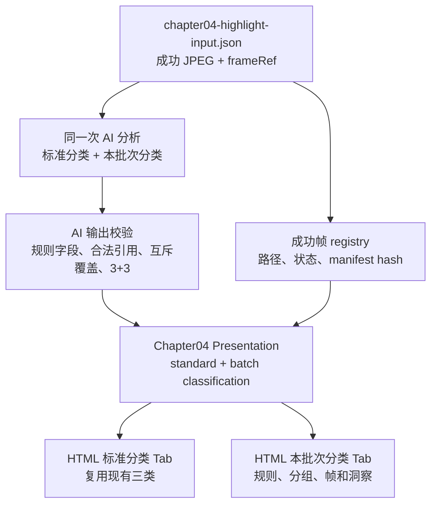

# 千川第四部分“本批次分类”设计文档

## 1. 目标

在 `04｜高光画面洞察` 中新增一个名为“本批次分类”的外层 Tab。该 Tab 展示 AI 基于本批次成功高光帧理解后形成的一套业务语义分类；现有“标准分类”及其人像、产品、其他画面内容保持原有数据、文案、图片、排序、分页和素材跳转行为。

本次只改 RPA 数据落盘后的 Chapter 04 后处理链路，不重新请求素材列表、不重复执行素材详情 RPA，不覆盖最新批次或历史报告产物。

## 2. 基线事实与边界

- 最新输入目录：`runs/20260904-top15-20260825-20260830`。
- Chapter 04 输入：`diagnostic-analysis/analysis-units/chapter04-highlight-input.json`。
- 当前输入包含 15 条 Top 素材和 89 张成功高光帧，每张帧都有 `highlight:<materialId>:<rankType>` 证据引用。
- AI 继续一次性读取 Chapter 04 高光帧事实和本地 JPEG；不由前端根据文件名、素材标题或已有标准分类猜测“本批次分类”。
- “标准分类”使用现有 `portrait`、`product`、`other` 三类；“本批次分类”是同一批帧上的另一套互斥分类体系。
- 当前第一部分的上新数口径保持现状：执行日 T 的 `[T-7, T-1]` 闭区间；本批次为 2026-08-28 至 2026-09-03，共 52 条。这个口径冲突不在本次 Chapter 04 变更范围内。

## 3. 用户界面设计

第四部分采用两层结构：

```text
04｜高光画面洞察
├── Tab：标准分类（默认）
│   ├── 现有人像画面
│   ├── 现有产品画面
│   └── 现有其他画面
└── Tab：本批次分类
    ├── 本批次规则说明
    ├── 分类数量与覆盖概览
    └── 分类卡片：帧分页、共性结论、裂变方向
```

“标准分类”是一个整体面板，三类不能被提升为与“本批次分类”并列的报告级 Tab。标准分类面板内部复用当前三类渲染器和既有交互；本批次面板使用独立的 `tabpanel`、分类列表和帧分页组件，默认不影响标准分类的 HTML 结构和数据顺序。

本批次分类面板需要支持：

1. 展示规则名称、规则说明、输入帧数、分类数和覆盖率。
2. 展示 AI 生成的分类名称、分类定义、帧数和占比。
3. 展示分类对应的高光帧，复用现有大图灯箱、素材跳转和分页能力。
4. 展示每类共性结论与裂变方向；每类沿用当前 3 条共性结论 + 3 条裂变方向契约。
5. 空数据时显示“本批次未生成分类”，不回退或篡改标准分类。
6. Tab、键盘焦点、`aria-selected`、`aria-controls` 和移动端布局保持可访问与不溢出。

## 4. 数据契约

在现有 AI 结论中增加 `customClassification` 字段，但对外展示名称固定为“本批次分类”：

```json
{
  "customClassification": {
    "ruleId": "batch_visual_mechanism_v1",
    "ruleName": "本批次画面机制分类",
    "ruleDescription": "按本批次成功高光帧中可观察的主要内容机制分组",
    "ruleVersion": "v1",
    "inputFrameManifestHash": "sha256:...",
    "groups": [
      {
        "groupId": "product-proof",
        "groupName": "产品证据展示",
        "description": "包装、内容物或操作动作承担主要说服作用的画面",
        "frameRefs": ["highlight:<materialId>:peak_top_1"],
        "commonConclusion": [
          {"title": "...", "body": "...", "evidenceRefs": ["highlight:<materialId>:peak_top_1"]}
        ],
        "derivativeDirections": [
          {"title": "...", "body": "...", "evidenceRefs": ["highlight:<materialId>:peak_top_1"]}
        ]
      }
    ],
    "unclassifiedFrameRefs": [],
    "availability": "available"
  }
}
```

约束如下：

- `groups` 至少 2 类；每类至少 1 张帧；分类名称必须是可解释的业务语义，不得使用“其他1”“其他2”等占位名称。
- `frameRefs` 只能来自 Chapter 04 成功高光帧；同一套本批次分类中每张成功帧必须恰好属于一个 group，未归类帧必须显式进入 `unclassifiedFrameRefs`。
- 分类数量、帧数和占比由 Presentation 根据 `frameRefs` 计算，AI 不提供或修正这些确定性数字。
- 共性结论、裂变方向的证据引用必须属于本组；每类保持 3+3，标题、正文和证据校验沿用现有门禁。
- 缺失、未知、重复或跨组引用只使本批次分类进入 `partial`/`unavailable`，不得影响标准分类。
- `ruleVersion` 和输入帧 manifest hash 用于复现检查；报告不写入签名 URL、凭证或远程过程信息。

AI schema 升级为兼容现有 v5 的新版本；旧 v4/v5 结果仍可正常渲染，只显示无本批次分类的降级状态。

## 5. 后端与报告链路



职责分工：

- `prompts/diagnostic-analysis-prompt-v1.md`：要求 AI 只按 JPEG 可观察内容生成规则和分组，并输出证据引用，不生成统计数值。
- `scripts/final_report_lib.py`：校验新字段、证据集合、分类互斥性、3+3 内容和降级状态。
- `scripts/qianchuan_presentation.py`：保留标准三分类投影，新增本批次分类投影；根据事实 registry 计算帧数和覆盖率。
- `scripts/report_renderer.py`：继续以 Presentation 和展示事实为输入，不在渲染阶段重新聚合分类。
- `templates/final-report-template.html`：增加外层 Tab，标准面板调用现有分类渲染，本批次面板调用新增渲染器。
- `assets/report/unified-report.css`、`assets/report/unified-report.js`：只增加本批次面板所需样式和交互，不改变标准分类既有选择器行为。

## 6. 验收标准

1. 最新批次可以从 Chapter 04 输入、AI JSON、Presentation 反查到 HTML；证据引用和 manifest 版本一致。
2. 报告第四部分只有“标准分类”和“本批次分类”两个报告级 Tab；标准分类内的人像、产品、其他仍在同一面板中，原有内容和交互不变。
3. 本批次分类每张成功帧只归属一个自定义分组；非法引用、重复引用、无分组和缺失 AI 输出均能稳定降级。
4. 本批次分类的帧数、占比和覆盖率由确定性投影计算，与 frame registry 一致。
5. 每个有效本批次分组均有 3 条共性结论和 3 条裂变方向，并且证据引用只属于该分组。
6. 标准分类、单素材跳转、灯箱、分页、Excel 下载和 ZIP 生成不回归。
7. 完成定向测试、全量测试、Python 语法检查、Node 语法检查、`git diff --check`，并以新目录生成真实 HTML/JSON/ZIP 验收；不覆盖旧报告。
